# REVENANT — Beginner's Study Guide
## Plan of Action (POA) with Flow Diagrams

---

## Big Picture: What Are You Learning?

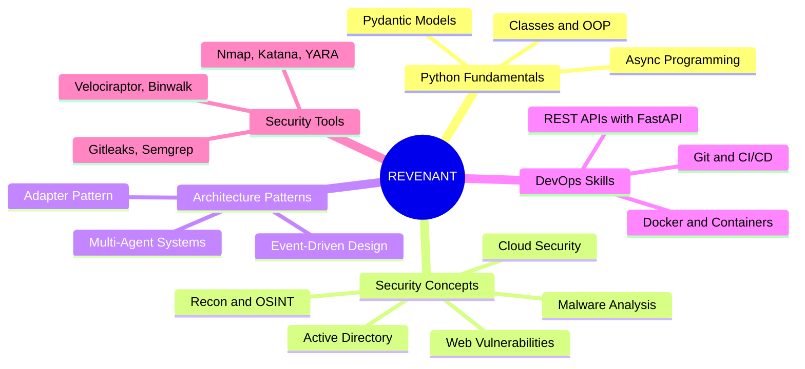

---

## Phase-wise Plan of Action (12 Weeks)

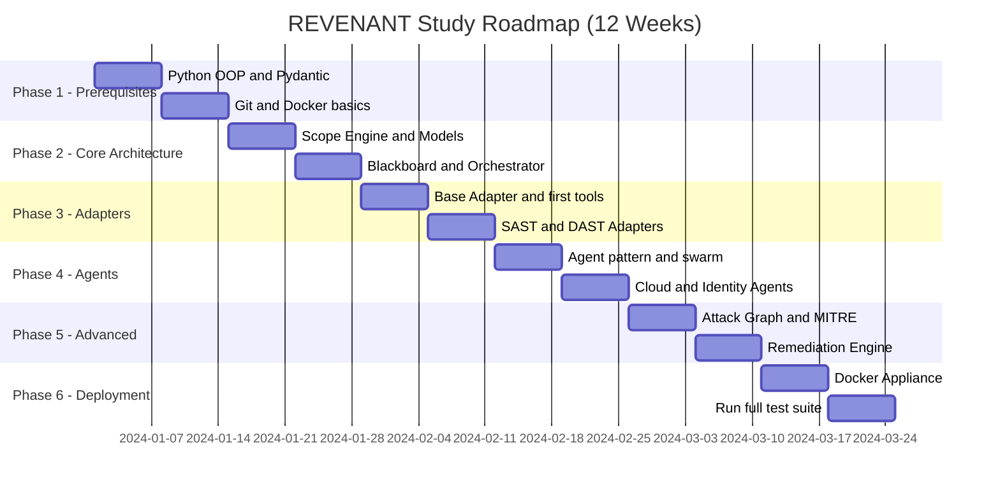

---

## Week 1-2: Prerequisites — What to Learn First

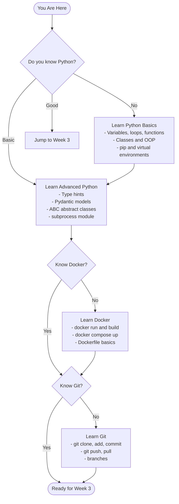

### Files to Read First

| File | Why Read It |
|------|-------------|
| `README.md` | Big picture overview of the project |
| `pyproject.toml` | All tool dependencies listed here |
| `revenant.py` | Entry point — how the platform starts |
| `control-plane/control_plane/schemas/models.py` | Core data models used everywhere |

---

## Week 3-4: Core Architecture

### The 3 Foundation Concepts

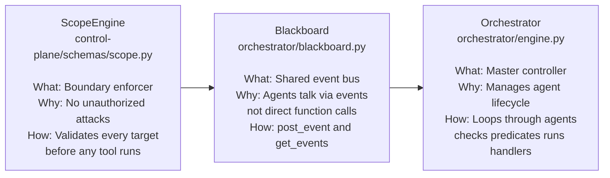

### How Events Flow Between Agents

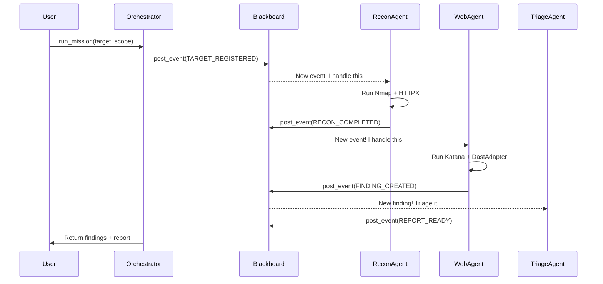

### Study Order for Core Files

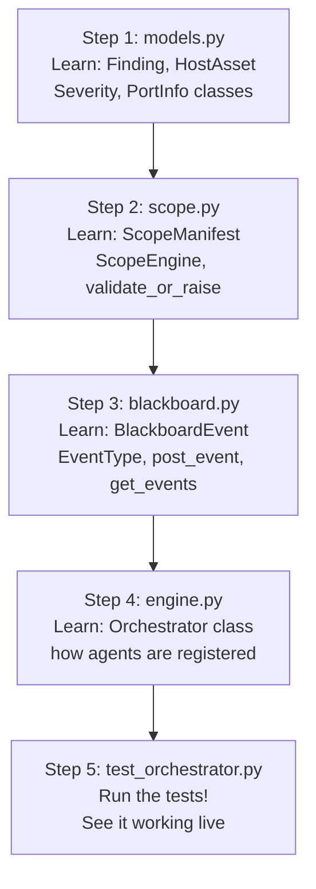

---

## Week 5-6: Understanding Adapters

### The Adapter Pattern (Every Adapter Works the Same Way)

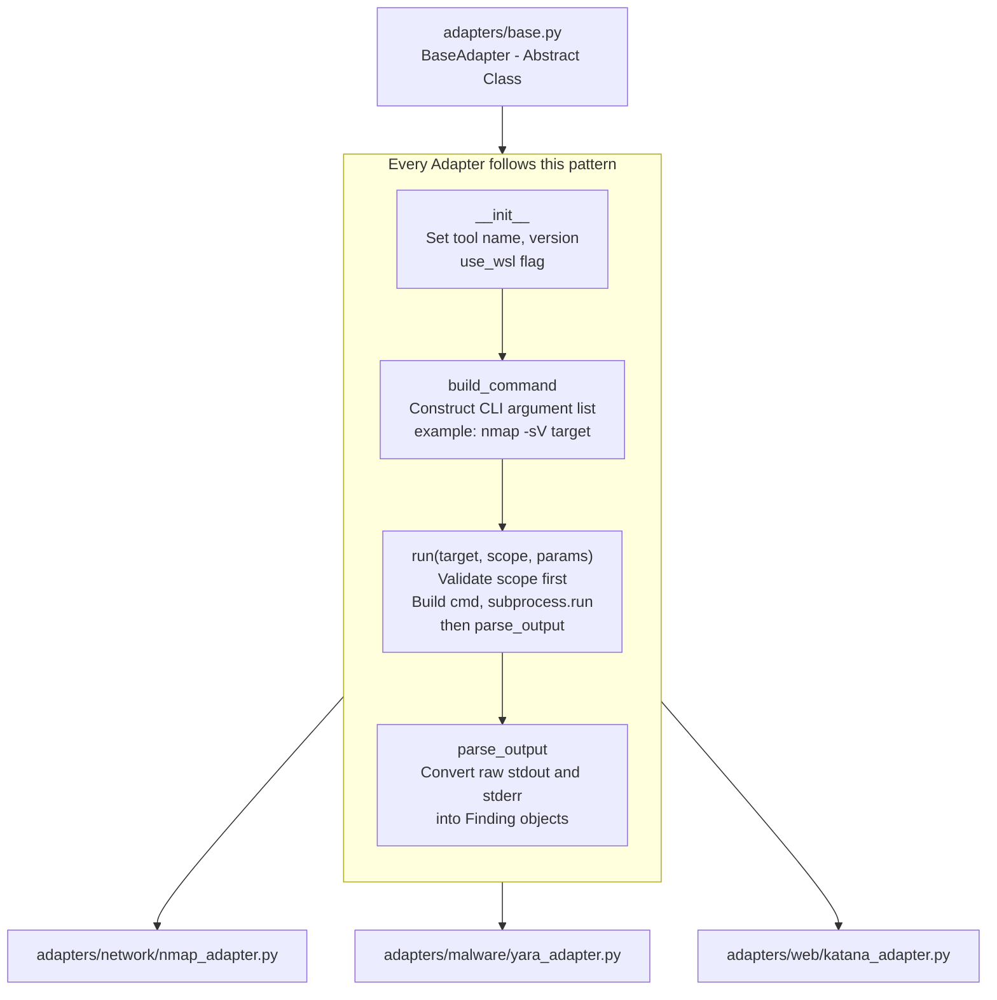

### Adapter Study Path (Start Simplest First)

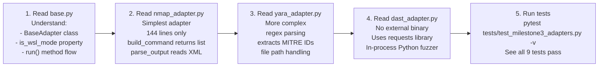

---

## Week 7-8: Agents and Swarm Intelligence

### How an Agent Decides Whether to Act

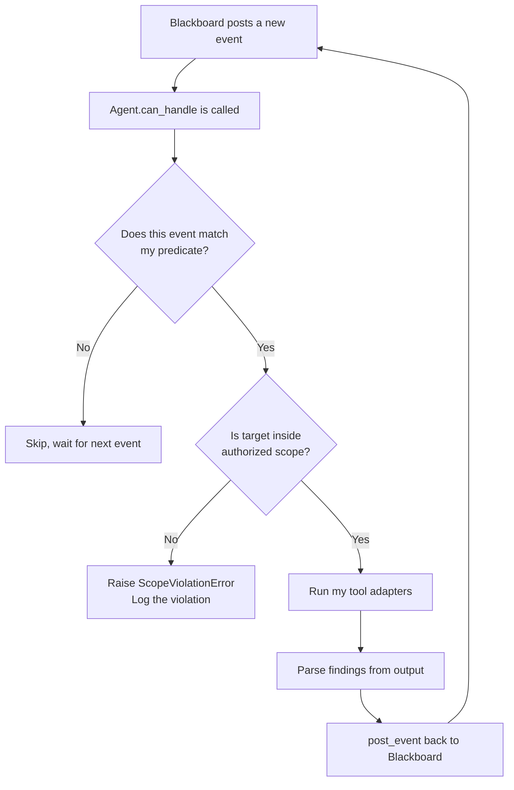

### All 15 Agents and What They Do

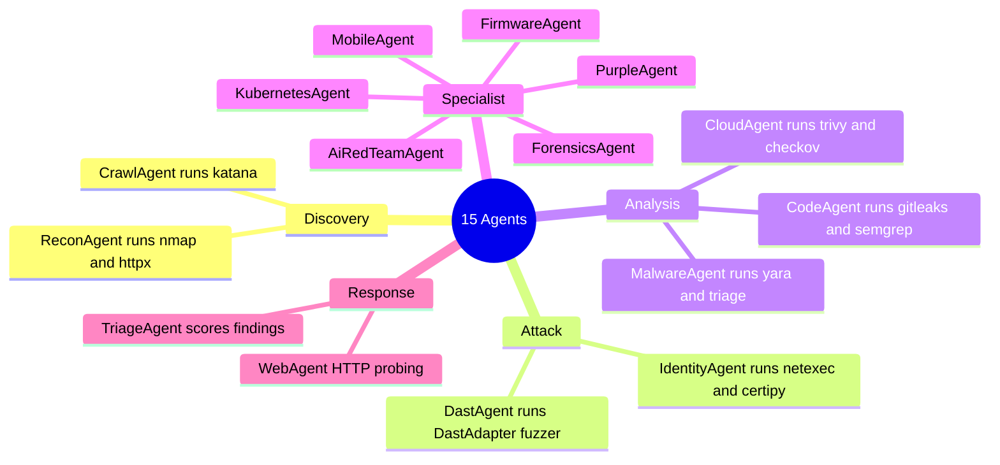

### Agent Study Path

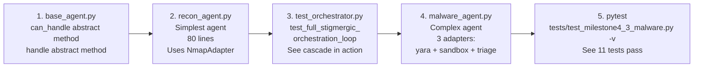

---

## Week 9-10: Attack Graph and Reporting

### How Individual Findings Become an Attack Story

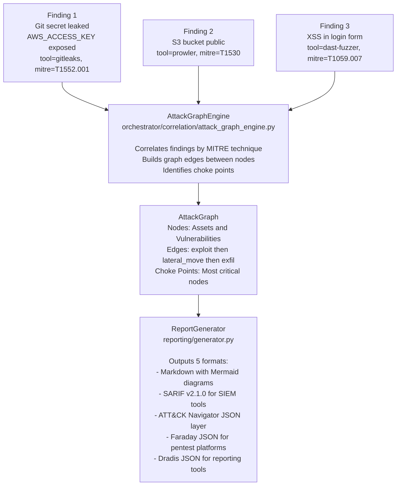

### Files to Study This Week

| File | What You Learn |
|------|----------------|
| `control-plane/schemas/attack_graph.py` | `AttackGraph`, `GraphNode`, `GraphEdge` structures |
| `orchestrator/correlation/attack_graph_engine.py` | How findings get correlated into chains |
| `reporting/mitre_mapper.py` | MITRE ATT&CK technique lookup table |
| `reporting/generator.py` | Report generation in 5 different formats |
| `tests/test_milestone2_5_attack_graph.py` | Run 8 tests to see correlation live |

---

## Week 11-12: Docker and Deployment

### How the 4-Container Stack Works Together

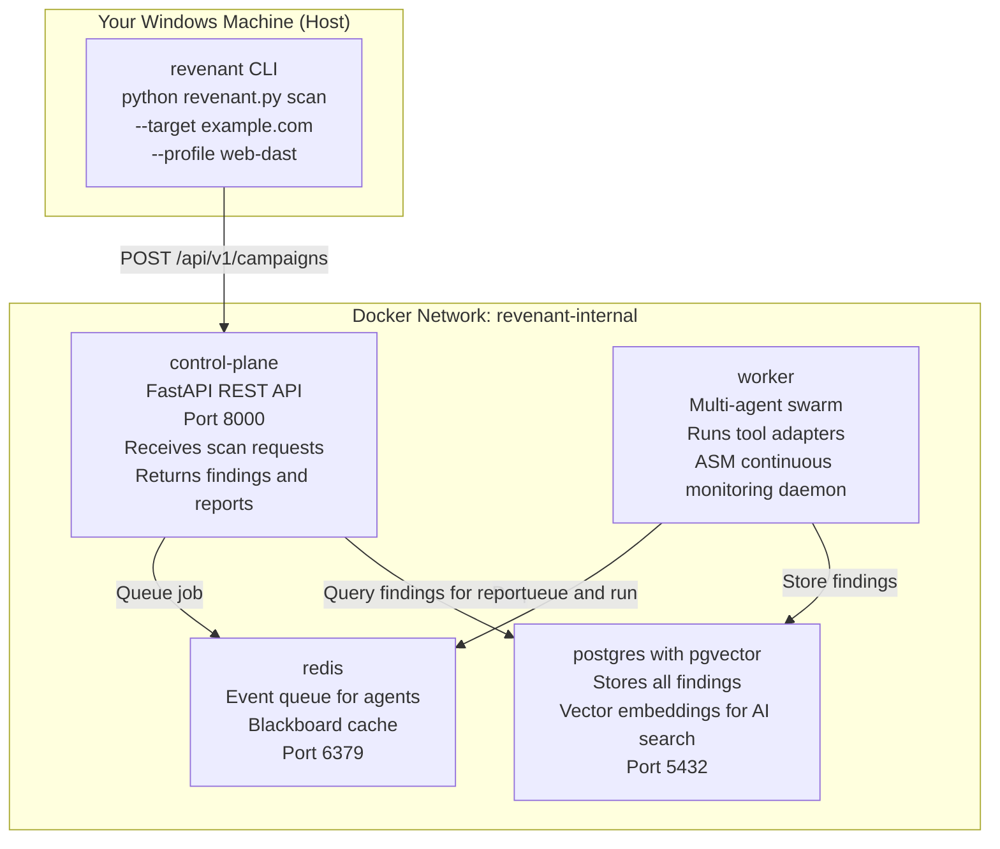

### Docker Commands to Master

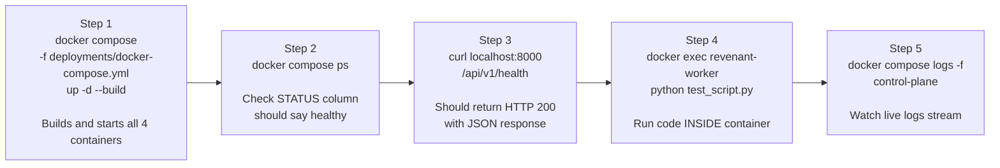

---

## Complete Study Order at a Glance

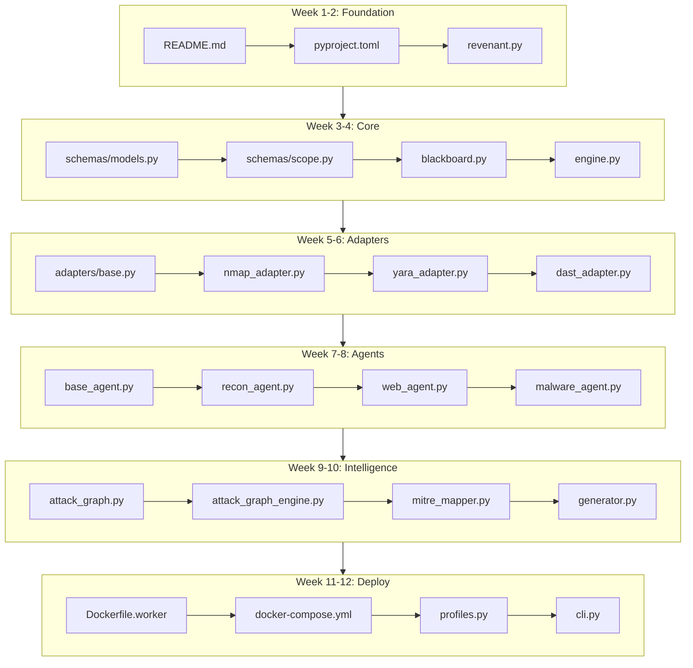

---

## Daily Study Routine (1.5 Hours/Day)

| Time Block | Activity |
|------------|----------|
| 30 min | Read the source file for that week's topic |
| 15 min | Read the corresponding test file |
| 30 min | Run `pytest tests/test_<file>.py -v -s` and read live output |
| 15 min | Modify one small thing and see what breaks |
| 15 min | Write notes and questions |

---

## Key Commands — Always Have These Ready

```bash
# Run all 234 tests
.venv\Scripts\pytest tests/ -q

# Run one test file with full live output
.venv\Scripts\pytest tests/test_orchestrator.py -v -s

# Run just one specific test
.venv\Scripts\pytest tests/test_milestone4_3_malware.py::TestLiveYaraScan -v -s

# Start the Docker stack
docker compose -f deployments/docker-compose.yml up -d

# Check all 4 containers are healthy
docker compose -f deployments/docker-compose.yml ps

# Hit the health endpoint from host
curl http://localhost:8000/api/v1/health

# Run a scan via CLI
python revenant.py scan --target http://localhost:3000 --profile web-dast

# See all available mission profiles
python revenant.py profiles

# Watch live container logs
docker compose -f deployments/docker-compose.yml logs -f control-plane
```

---

## Self-Assessment Checkpoints

Mark each one when you can answer it without looking:

- [ ] **Week 2**: What does `ScopeEngine.validate_or_raise()` do and when does it get called?
- [ ] **Week 4**: What happens step-by-step when `Blackboard.post_event()` is called?
- [ ] **Week 6**: What 4 methods must every adapter implement and what do they return?
- [ ] **Week 8**: Why does `can_handle()` exist? What would break without it?
- [ ] **Week 10**: What is a "choke point" in an attack graph and why does it matter?
- [ ] **Week 12**: Run `docker compose up` yourself and successfully hit the health endpoint from your machine.
