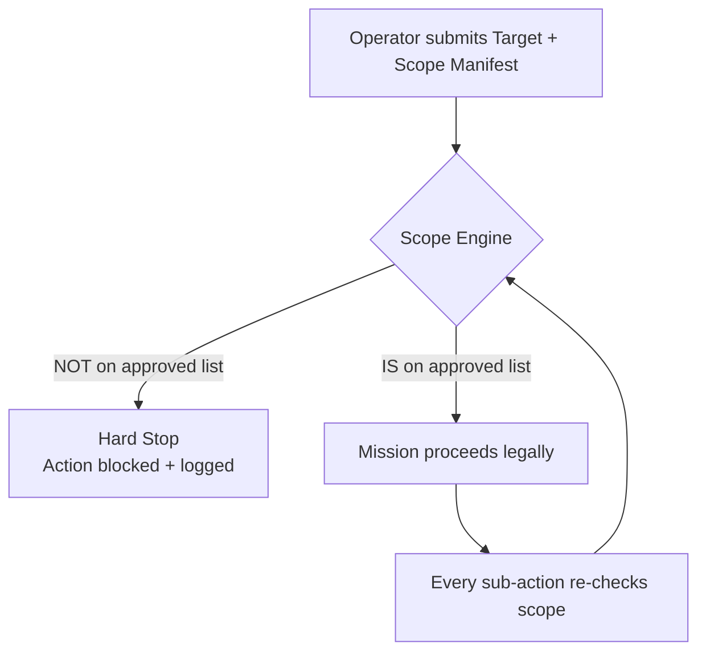
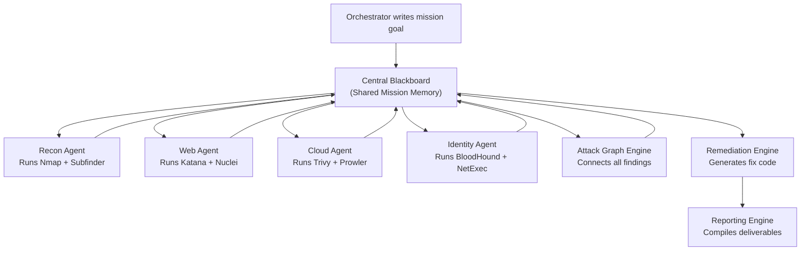
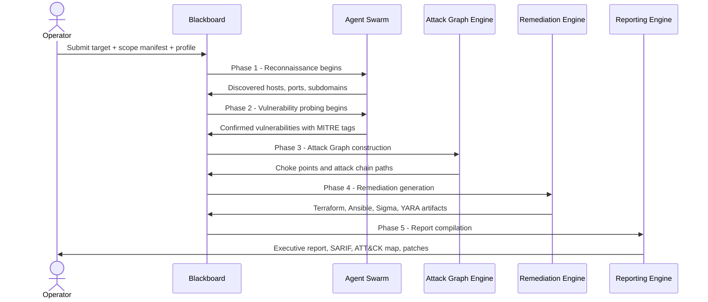
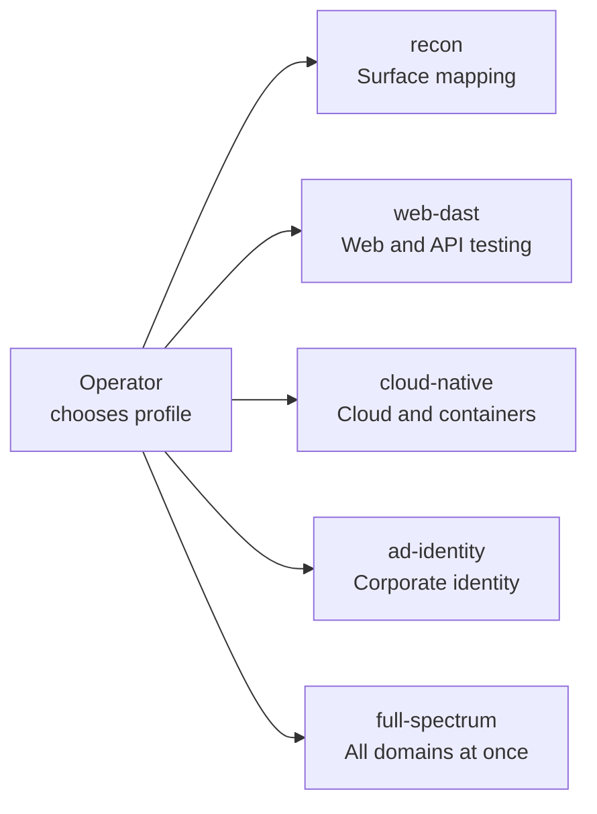
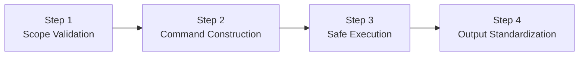
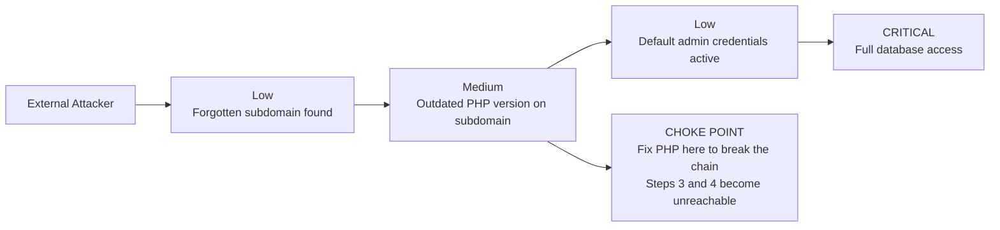
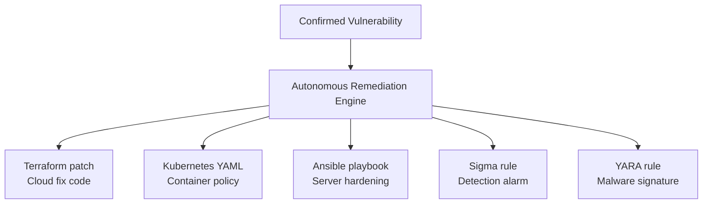
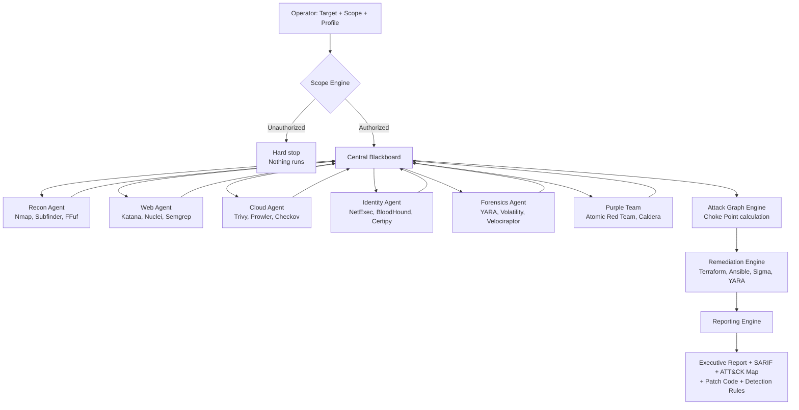

# REVENANT — The Universal Study Companion

> A complete, plain-English guide for anyone — technical or not — to understand everything about REVENANT: what it is, how it thinks, every tool it uses, and what it ultimately produces.

---

## Table of Contents

1. [What is REVENANT?](#1-what-is-revenant)
2. [The Safety Rule: Scope and Authorization](#2-the-safety-rule-scope-and-authorization)
3. [How REVENANT Thinks: The Blackboard and the Swarm](#3-how-revenant-thinks-the-blackboard-and-the-swarm)
4. [The Complete Lifecycle of a Security Mission](#4-the-complete-lifecycle-of-a-security-mission)
5. [The Five Mission Profiles](#5-the-five-mission-profiles)
6. [Every Tool in REVENANT Explained](#6-every-tool-in-revenant-explained)
7. [The Adapter System](#7-the-adapter-system)
8. [Attack Graphs and Choke Points](#8-attack-graphs-and-choke-points)
9. [Autonomous Remediation Engine](#9-autonomous-remediation-engine)
10. [How You Interact With REVENANT](#10-how-you-interact-with-revenant)
11. [Final Deliverables](#11-final-deliverables)
12. [The Full Mental Model](#12-the-full-mental-model)
13. [Glossary](#13-glossary)

---

## 1. What is REVENANT?

Imagine you run a company with a website, servers, a corporate office network, and a cloud storage account full of customer data. You hire the best security locks, firewalls, and monitoring cameras money can buy. But the real question is: **have you actually tested whether any of those protections can be bypassed?**

In the real world, organizations hire specialized teams called **Red Teams** — ethical, authorized security professionals whose entire job is to think and act exactly like a real attacker. They try to break in, expose the weak points, and hand the company a blueprint for fixing them before a criminal does it first.

The problem with human Red Teams is that they are expensive, slow, and limited. A three-person team cannot simultaneously audit a web application, a cloud account, an internal office network, and a mobile API at the same time. Real enterprise environments are too large and change too fast.

**REVENANT** is an autonomous artificial intelligence platform that acts as an entire Red Team operating simultaneously. It never sleeps, never misses a scan, legally and safely tests every corner of an enterprise's technology stack, and at the end, not only reports the problems but generates the ready-to-use code to fix them. It is an attacker, a detective, an intelligence analyst, and a repair engineer all bundled into one automated system.

---

## 2. The Safety Rule: Scope and Authorization

The most important principle in offensive security is this: **you can only test systems you are authorized to test**. Testing someone else's computer without written permission is illegal in every country on earth.

REVENANT is built around this rule at its very core. It operates with a concept called the **Scope Manifest** — a digitally signed, legally binding document that the operator provides before any assessment begins. This document lists exactly which web addresses, server IP ranges, cloud accounts, and internal networks are approved for testing. Nothing outside this list will ever be touched, no matter what.

The **Scope Engine** acts as the permanent gatekeeper of the entire platform. Before any agent, tool, or script sends a single network packet, it asks the Scope Engine: "Is this target on the approved list?" If the answer is no, the action is halted immediately and logged as a scope violation.

> **Why this matters:** This is not optional configuration — it is a non-negotiable safety layer baked into the foundation of every component in REVENANT. Even mid-mission, every tool call passes through this check before executing.

---

## 3. How REVENANT Thinks: The Blackboard and the Swarm

Most software programs follow a fixed script — Step 1 runs, then Step 2, then Step 3. If Step 2 encounters something unexpected, the entire process stalls or crashes.

REVENANT is fundamentally different. It is built on an architecture called a **Stigmergic Multi-Agent Blackboard System**. Picture a hospital emergency room. No single doctor manages every procedure by personally directing each nurse one by one. Instead, there is a central patient chart — the **Blackboard** — that every specialist can read and write to. The cardiologist adds findings, the radiologist sees them and acts, the anaesthesiologist steps in only when relevant. No one gives orders to anyone else. They all respond to the evolving state of the shared record.

REVENANT's **Agents** are those expert specialists. When the mission begins, the orchestrator writes the objective on the Blackboard. Agents continuously monitor it and act the moment they see something relevant to their specialization.

**Three key advantages of this design:**

- **Parallel execution** — The web agent and cloud agent work simultaneously without waiting for each other.
- **Dynamic adaptation** — If the recon agent unexpectedly discovers a Kubernetes cluster nobody knew about, the cloud agent steps in automatically.
- **Fault tolerance** — If one agent errors, the others continue independently and post their findings to the board.

---

## 4. The Complete Lifecycle of a Security Mission

Every REVENANT assessment moves through five distinct phases. Here is exactly what happens at each stage.

| Phase | Name | What Happens |
|:---:|:---|:---|
| 1 | **Reconnaissance** | Discover every domain, subdomain, IP, open port, and exposed directory. Draw the complete floor plan before testing any locks. |
| 2 | **Vulnerability Probing** | Test each asset based on its technology — web apps are crawled and fuzzed, cloud accounts are audited, corporate networks are tested for credential weaknesses. |
| 3 | **Attack Graph Construction** | Connect individual findings into a graph. Calculate which sequence of weaknesses an attacker would chain together to reach the most sensitive target. |
| 4 | **Autonomous Remediation** | Generate production-ready fix code for every confirmed vulnerability — cloud scripts, container policies, server playbooks, and detection rules. |
| 5 | **Reporting** | Produce six formats of output simultaneously, each targeted at a different stakeholder — from the CEO to the cloud engineer to the SOC analyst. |

---

## 5. The Five Mission Profiles

REVENANT does not run the same assessment every time. An operator chooses a **Mission Profile** at the start, which tells REVENANT which specialist agents to activate and which domains to focus on. Think of profiles as preset camera modes — from a quick portrait shot to a full, high-resolution panoramic exposure.

### recon — Surface Mapping

**Purpose:** Get a complete inventory of everything the target exposes before committing to deeper testing. This is the fastest, quietest profile. It discovers subdomains, open ports, service versions, and hidden web directories. It does **not** probe for vulnerabilities or attempt any exploitation.

**When to use:** First look at a new target, or a periodic check for new assets that appeared since the last audit.

| Tool | Role |
|:---|:---|
| Subfinder | Discovers every subdomain associated with the target domain |
| Nmap | Maps open ports and identifies running service versions |
| FFuf | Discovers hidden directories and endpoints using wordlist guessing |

---

### web-dast — Web and API Security Testing

**Purpose:** Comprehensively test every web application, API endpoint, and user-facing interface for exploitable vulnerabilities. Includes crawling every page and form, sending malformed inputs to APIs, testing authentication logic, checking for data leakage, and scanning source code for insecure patterns.

**When to use:** Before a new web app or API goes live, or for periodic web security validation.

| Tool | Role |
|:---|:---|
| Katana | Crawls and maps every page, form, and API endpoint |
| Nuclei | Fires thousands of targeted vulnerability template checks |
| Semgrep | Scans source code for insecure patterns (SAST) |
| Schemathesis | Fuzzes APIs with unexpected inputs using OpenAPI specs |
| Native DAST Adapter | Tests for XSS, Open Redirects, and Path Traversal directly |
| FFuf | Fuzzes endpoints for hidden paths and parameters |

---

### cloud-native — Cloud Infrastructure and Container Security

**Purpose:** Audit the security posture of cloud accounts and container environments. Checks whether cloud storage is accidentally public, whether servers have excessive permissions, whether container images contain known vulnerabilities, and whether Kubernetes clusters allow containers to escape their boundaries.

**When to use:** When running infrastructure on AWS, Azure, or Kubernetes and wanting to verify configuration meets global security standards.

| Tool | Role |
|:---|:---|
| Trivy | Scans container images and IaC files for known CVEs |
| Prowler | Audits AWS and Azure accounts against CIS and GDPR benchmarks |
| Checkov | Scans Terraform and Kubernetes files for misconfigurations before deployment |
| Kubescape | Evaluates Kubernetes cluster config against NSA/CISA guidance |
| Kube-bench | Checks each cluster node against the CIS Kubernetes Benchmark |
| Falco | Monitors running containers in real time for behavioral anomalies |

---

### ad-identity — Active Directory and Corporate Identity

**Purpose:** Test the internal corporate network's identity and access management infrastructure. Discovers whether accounts can be compromised through weak passwords, whether permission misconfigurations create hidden paths to administrator access, and whether the corporate certificate authority is misconfigured.

**When to use:** To simulate an internal threat — a compromised employee account — and measure how far damage could spread.

| Tool | Role |
|:---|:---|
| NetExec | Tests whether credentials can authenticate across multiple internal services |
| BloodHound | Maps all AD relationships and finds hidden paths to Domain Admin |
| Certipy | Audits Active Directory Certificate Services for ESC1-ESC8 misconfigurations |

---

### full-spectrum — Complete Enterprise Assessment

**Purpose:** Activate all five domains simultaneously. Every agent coordinates concurrently, findings correlate across all domains, and the full attack graph is built from the external entry point to the innermost sensitive resource. Ends with complete remediation and all six reporting formats.

**When to use:** Annual security assessments, compliance audits, or full multi-stage adversarial campaign simulations.

> **Tools activated:** Every tool in the ecosystem, plus the Attack Graph Engine, Autonomous Remediation Engine, and all six report exporters.

---

## 6. Every Tool in REVENANT Explained

REVENANT integrates 20+ battle-tested security tools across six operational domains. Here is every tool, what it does, and why REVENANT uses it.

### Domain 1: Network and Perimeter

**Nmap — Network Mapper**
Nmap is the oldest and most trusted network scanning tool in the world. It knocks on every digital door (called a port) and listens for what answers. From the response, Nmap identifies the exact software and version running — for example, "Apache HTTP Server 2.4.49 on port 80." This directly informs which specific vulnerabilities to test for next. Without Nmap, REVENANT would be walking into a building completely blind.

**Subfinder — Subdomain Discovery**
Large companies have dozens of subdomains — separate addresses for different services like mail.company.com, api.company.com, staging.company.com, or admin.company.com. These are often created for testing and forgotten, left unpatched and vulnerable. Subfinder scours public internet records, certificate transparency logs, and DNS databases to build a complete list of every subdomain associated with a target domain.

**FFuf — Web Directory Fuzzing**
Even after mapping known subdomains, hidden content lurks behind unlisted URLs. FFuf rapidly fires thousands of web address guesses per second using wordlists (pre-built lists of common directory and file names) to discover pages not linked anywhere publicly — like /admin, /backup, /config.php, or /.git. These hidden paths often contain sensitive information or outdated software that becomes an easy entry point.

---

### Domain 2: Web and Application Security

**Katana — Web Crawler**
Before you can test a web application for vulnerabilities, you need to know every page, form, button, and API endpoint it has. Katana is a high-speed automated browser that navigates websites the way a human would — clicking links, submitting forms, following redirects — but at machine speed, mapping every reachable endpoint in seconds.

**Nuclei — Template-Based Vulnerability Scanner**
Nuclei uses a library of thousands of community-written templates — each one a precise test for a specific known vulnerability, misconfiguration, or security weakness. When REVENANT runs Nuclei against a discovered web service, it simultaneously fires hundreds of targeted checks: Is this server running software with a known CVE? Is the security header misconfigured? Does this endpoint expose debug information? Is there an admin panel with default credentials?

**Semgrep — Static Application Security Testing (SAST)**
While Nuclei tests running applications from the outside, Semgrep reads source code from the inside. It scans code line by line using pattern-matching rules to find insecure coding patterns before the software is even deployed — SQL queries that concatenate user input directly (SQL injection risk), hardcoded API keys, dangerous cryptographic functions, or missing input validation.

**Schemathesis — API Property-Based Fuzzing**
Modern web services expose APIs that document their expected inputs using OpenAPI specifications. Schemathesis reads these specifications and then systematically feeds the API unexpected inputs — extreme values, empty strings, special characters, reversed data types — to expose edge cases where the API crashes, exposes internal errors, or returns data it should not. This catches logical flaws that rule-based scanners completely miss.

**Native DAST Adapter — In-Process Web Fuzzer**
REVENANT's own built-in dynamic testing engine written in Python. This adapter directly tests for three critical web vulnerability classes: Cross-Site Scripting (XSS, where malicious scripts are injected into web pages), Open Redirects (where an attacker tricks a website into sending users to a malicious address), and Path Traversal (where attackers navigate outside the web application's intended directories to read server files).

---

### Domain 3: Cloud and Container Security

**Trivy — Container and Infrastructure Vulnerability Scanner**
Modern applications are packaged into "containers" — isolated bundles of software built from "images" that often include operating system packages, libraries, and dependencies. If those components have known security vulnerabilities (CVEs), the container is a liability. Trivy scans container images, file systems, and infrastructure-as-code configurations to detect known CVEs, misconfigurations, and sensitive data.

**Prowler — Cloud Security Posture Management**
Prowler audits cloud accounts against hundreds of security checks derived from global standards like the CIS Benchmark, SOC 2, and GDPR requirements. It answers questions like: Are any S3 storage buckets publicly readable? Is multi-factor authentication enforced on all administrator accounts? Are security groups allowing unrestricted inbound traffic from the entire internet?

**Checkov — Infrastructure-as-Code Security Scanner**
Modern cloud infrastructure is defined in code files — Terraform scripts, CloudFormation templates, Kubernetes YAML manifests. Checkov scans these files before they are deployed to catch misconfigurations at the blueprint stage — for example, a Terraform file that will create a database with no encryption, or a Kubernetes manifest that will create a container running as the root user.

**Kubescape and Kube-bench — Kubernetes Security Hardening**
Kubernetes is the dominant platform for orchestrating containers at scale. A container that escapes its sandbox can compromise the entire host machine. Kubescape evaluates cluster configurations against NSA/CISA Kubernetes Hardening Guidance. Kube-bench checks every node against the CIS Kubernetes Benchmark.

**Falco — Runtime Security and Anomaly Detection**
Falco monitors running containers in real time, watching for behavioral anomalies that indicate something has gone wrong: a web server process suddenly opening a shell, a container reading system password files, a process establishing an outbound connection to an unknown IP address. While the other cloud tools audit configuration, Falco catches active threats happening live.

---

### Domain 4: Identity and Active Directory

**NetExec — Network Credential Validation**
NetExec tests whether a set of credentials — perhaps discovered through a phishing simulation or a credential dump — can be used to authenticate against multiple services on an internal corporate network simultaneously. Services tested include SMB file shares, RDP remote desktop, WinRM management, and LDAP directory services. This reveals password reuse across multiple systems — one of the most common ways attackers pivot through corporate networks.

**BloodHound — Active Directory Attack Path Mapping**
Active Directory manages which employee accounts can access which computers, servers, and resources. BloodHound ingests all of Active Directory's relationships — users, groups, computers, permissions, and trust links — and maps them into a visual web. It then runs graph algorithms to find non-obvious paths from a low-privilege user account all the way to Domain Administrator. These paths often involve obscure permission delegations that no human administrator would think to audit.

**Certipy — Active Directory Certificate Services Auditing**
Many organizations run their own internal certificate authority using Microsoft Active Directory Certificate Services (AD CS). AD CS misconfigurations — classified as ESC1 through ESC8 — can allow a low-privilege account to request a certificate that authenticates it as a Domain Administrator. Certipy automatically enumerates certificate templates, authority configurations, and permissions in an AD CS environment and flags which specific misconfigurations are present.

---

### Domain 5: Forensics, Malware, and Threat Simulation

**YARA — Malware Pattern Matching**
YARA is the industry standard for writing rules that describe malicious software. Each YARA rule is a signature — a set of strings, byte patterns, and logical conditions that identify a specific piece of malware, a webshell, or a hacking tool. REVENANT uses YARA to scan files and memory regions against libraries of thousands of rules covering known ransomware, remote access trojans, and web shells. REVENANT also auto-generates new YARA rules for the specific malware artifacts it simulates during an engagement.

**Volatility 3 — Memory Forensics**
Sophisticated attackers and modern malware often operate entirely in RAM — they never write any files to the hard drive, making them invisible to traditional antivirus software. Volatility analyzes a snapshot (dump) of a computer's RAM and can extract running processes, network connections, loaded kernel modules, encryption keys, command histories, and injected malicious code — all without ever touching the hard disk.

**Velociraptor — Live Endpoint Forensics and Triage**
Where Volatility analyzes memory dumps from individual computers, Velociraptor can simultaneously interrogate thousands of live machines across an entire organization using VQL (Velociraptor Query Language). It can answer questions like: "Show me every machine that ran this executable in the last 48 hours," or "List all machines with a suspicious new service installed."

**Binwalk — Firmware Analysis**
When REVENANT operates in firmware security mode (relevant for IoT devices, network appliances, and embedded systems), Binwalk extracts, decompresses, and analyzes firmware binary images. It identifies embedded file systems, configuration files, encryption keys, and known vulnerable libraries packed inside firmware.

**CAPEv2 — Malware Sandbox and Dynamic Analysis**
CAPEv2 is a malware analysis sandbox. When a suspicious file or payload needs to be analyzed, CAPEv2 runs it in an isolated, instrumented virtual machine and records everything the malware does: which files it creates, which registry keys it modifies, which network connections it makes, which processes it injects into. REVENANT uses CAPEv2 to dynamically profile custom payloads, producing behavioral reports that inform detection rule generation.

---

### Domain 6: Purple Teaming and Adversary Simulation

**Atomic Red Team — Adversary Technique Simulation**
Atomic Red Team is a library of small, focused test scripts — called "atomics" — each simulating one specific attacker technique catalogued in the MITRE ATT&CK framework. For example, an atomic for T1059 simulates malicious command-line execution; an atomic for T1003 simulates credential dumping. REVENANT executes these atomics in a controlled manner to test whether an organization's endpoint detection and SIEM alarms actually fire correctly when real attacker behaviors occur.

**Caldera — Automated Adversary Emulation**
Caldera takes adversary simulation further than individual atomics. It is a full adversary emulation platform that can deploy autonomous agents on target machines, chain multiple ATT&CK techniques together into complete campaigns, and adapt its behavior based on what it discovers. REVENANT integrates with Caldera to run multi-stage attack simulations — from initial access through lateral movement, privilege escalation, and data exfiltration.

---

## 7. The Adapter System

Each of the 20+ tools above speaks a completely different language. Nmap outputs XML. YARA outputs custom text. Katana streams JSON lines. Nuclei uses a structured template format. If REVENANT had to write unique parsing code for every tool's output, the system would be impossible to maintain.

The **Adapter System** solves this by giving every tool an identical four-step wrapper — a universal translator. No matter what language a tool speaks natively, its adapter converts everything into a single, clean standard that the rest of REVENANT understands.

| Step | What Happens |
|:---:|:---|
| **1. Scope Validation** | Before touching anything, the adapter verifies the target is on the authorized scope list. If not — full stop, no action. |
| **2. Command Construction** | The adapter constructs the exact command-line instruction needed to run the tool correctly with the right flags and targets. |
| **3. Safe Execution** | The command is run in an isolated environment. The adapter captures all raw output — text, XML, JSON — whatever the tool produces. |
| **4. Output Standardization** | Raw output is parsed and converted into a clean, uniform **Finding** object — the same format regardless of which tool ran. |

Every Finding record always contains:

| Field | What It Contains |
|:---|:---|
| **title** | A clear name for the vulnerability |
| **description** | A plain-language explanation of what was found and why it matters |
| **location** | The exact URL, IP address, file path, or service where the issue exists |
| **severity** | Rated as Critical, High, Medium, Low, or Informational |
| **mitre_technique** | The global ATT&CK technique ID this finding maps to (e.g., T1190) |

Because every single tool in the ecosystem outputs identical Finding records, the blackboard, attack graph engine, remediation engine, and reporting engine never need to know which tool found a given issue. **The system is fully modular** — new tools can be added by writing one new adapter, and the rest of the platform automatically benefits.

---

## 8. Attack Graphs and Choke Points

This is the capability that fundamentally separates REVENANT from a collection of automated scanners. Any scanner can find individual vulnerabilities. REVENANT finds the **narrative** — the story of how an attacker would move through your environment from beginning to end.

### The Core Problem: Lists vs. Graphs

Traditional security reports deliver a list of findings sorted by severity. The team patches the "Critical" items first, then works down the list. This sounds logical but is deeply flawed. Many devastating breaches are assembled from entirely "Low" and "Medium" severity findings that, in isolation, seem harmless.

> Real attackers do not see a list. They see a **graph of trust relationships**. They ask: "What can I reach from here? What does this access give me? How do I get from this low-privilege position to that high-value target?"

### How REVENANT Builds the Graph

After all agents complete their probing, REVENANT's Attack Graph Engine ingests every Finding from the blackboard and constructs a mathematical graph where nodes represent assets and findings, and edges represent exploitable relationships between them.

**The key insight from this diagram:** Four individually "Low" and "Medium" findings chain together into a Critical breach. REVENANT sees the chain. A standard vulnerability scanner sees four separate items and rates them low priority.

### The Choke Point Calculation

Once all attack paths are mapped, REVENANT calculates which single node, if hardened, eliminates the greatest number of distinct attack paths simultaneously. This is the **Choke Point**.

Think of it like a city's water supply. You could repair every individual leaking pipe across the city — which takes months and enormous resources. Or, if you identify the one main valve that feeds sixty percent of those leaking pipes, you turn that one valve and stop the majority of the leaks in seconds.

Choke Points transform remediation from an overwhelming 200-item list into a **focused, high-impact action plan**: maximum security improvement for minimum engineering effort.

---

## 9. Autonomous Remediation Engine

Most security platforms hand you the problem and leave you to figure out the solution. REVENANT does not stop at discovery. For every confirmed vulnerability, the Remediation Engine synthesizes production-ready defense code tailored to the exact technology stack involved.

| Output Type | What It Is | Who Uses It |
|:---|:---|:---|
| **Terraform patch** | Cloud infrastructure code describing the corrected state — how an S3 bucket should be configured to be private, how an IAM role should be scoped | Cloud engineers and DevOps teams |
| **Kubernetes manifest** | NetworkPolicy file that explicitly states which containers are allowed to communicate with which others, and denies everything else by default | Container and platform engineers |
| **Ansible playbook** | Server automation script that disables old insecure protocols like SMBv1, enforces encrypted SSH authentication, removes default user accounts | System administrators |
| **Sigma rule** | Vendor-neutral detection rule specification describing the behavioral pattern of an attack technique, convertible to Splunk, Sentinel, Elastic, and IBM QRadar | SOC analysts and threat hunters |
| **YARA rule** | File and memory signature rule that fingerprints the specific malware artifacts, payloads, or webshells involved, so future instances are automatically detected | Endpoint security teams |

---

## 10. How You Interact With REVENANT

REVENANT is designed for two modes of operation.

**Direct Command-Line Mode** is for individual engineers and security consultants running targeted assessments. A single command specifying the target, the scope manifest file, and the desired profile launches the entire platform. All results are saved to a local evidence directory.

**Appliance Mode** is for enterprise security operations teams. REVENANT is deployed as a containerized appliance using Docker Compose, running continuously in the background. In this mode, it exposes a REST API that allows other systems to trigger scans programmatically, schedule recurring assessments, integrate findings directly into vulnerability management dashboards, and send alerts to SOAR platforms like Splunk Phantom or Cortex XSOAR when critical findings are confirmed.

---

## 11. Final Deliverables

When a mission concludes, REVENANT produces six distinct output formats simultaneously, each crafted for a different audience within an organization.

| Output Format | Audience | What It Contains | Why It Matters |
|:---|:---|:---|:---|
| **Executive Markdown Report** | CEO, CISO, Compliance Team | Plain-language risk summary, business impact, and prioritized actions | Leaders need to understand business risk, not technical jargon |
| **SARIF v2.1.0 Log** | Software Developers | Machine-readable vulnerability data with exact file paths and line numbers | Integrates natively with GitHub, GitLab, and VS Code to show findings inline in code |
| **MITRE ATT&CK Navigator Layer** | Security Operations Center | Heatmap of every attacker technique simulated during the mission | Shows which techniques the organization has no detection coverage for |
| **Terraform and Ansible Patches** | Cloud Engineers, DevOps | Ready-to-deploy infrastructure fix code for every confirmed finding | Eliminates the engineering effort of writing remediation code from scratch |
| **Sigma and YARA Rules** | SOC Analysts, Threat Hunters | Detection rules deployable to any SIEM or EDR platform | Converts offensive findings directly into defensive detection capability |
| **Faraday and Dradis Exports** | Security Managers | Structured findings importable into vulnerability management platforms | Enables long-term tracking of remediation progress across multiple assessments |

---

## 12. The Full Mental Model

If you have read this entire document, here is everything distilled into one cohesive picture — from the operator's first command to the final deliverables.

> **REVENANT is not a scanner. It is not a checklist.** It is an autonomous, self-coordinating security intelligence system that thinks in attack chains, operates within strict legal boundaries, and closes the loop from discovery all the way to defense — without a human needing to babysit every step.

---

## 13. Glossary

| Term | Plain-English Meaning |
|:---|:---|
| **Red Team** | An authorized ethical team that simulates real attackers to expose weaknesses before criminals do. |
| **Blue Team** | The defense team that monitors systems, detects threats, and responds to incidents. |
| **Purple Team** | A collaborative exercise where Red and Blue teams work together to test attack simulations and tune detection responses simultaneously. |
| **Scope Manifest** | A signed, legally binding document defining exactly which systems are authorized for testing. Nothing outside this list is touched. |
| **Blackboard** | The central shared memory that all autonomous agents read from and write to without communicating directly with each other. |
| **Agent** | An autonomous software specialist that monitors the blackboard and acts on findings relevant to its domain. |
| **SAST** | Static Application Security Testing — scanning source code without running it to find insecure patterns. |
| **DAST** | Dynamic Application Security Testing — probing a running application from the outside by sending it real traffic. |
| **CVE** | Common Vulnerabilities and Exposures — a globally numbered database of known software security flaws. |
| **CIS Benchmark** | Center for Internet Security Benchmark — globally recognized configuration standards for securely setting up systems and cloud services. |
| **MITRE ATT&CK** | A globally recognized framework cataloguing every technique real-world attackers use, organized by tactic. |
| **Attack Graph** | A mathematical map of all the paths an attacker could take through a network from entry point to sensitive target. |
| **Choke Point** | The single most impactful node in the attack graph — fixing it collapses the most attack paths simultaneously. |
| **Remediation** | The process of repairing a vulnerability — in REVENANT's case, by generating ready-to-deploy fix code automatically. |
| **SARIF** | Static Analysis Results Interchange Format — a standard machine-readable format for security findings used by developer tooling like GitHub and VS Code. |
| **Sigma** | A vendor-neutral detection rule language that can be converted to work with any SIEM platform. |
| **YARA** | A pattern-matching language used to write signatures that identify malware, webshells, and hacking tools in files and memory. |
| **Terraform** | Infrastructure-as-Code tool that defines and deploys cloud resources through configuration files. |
| **Ansible** | An automation tool that applies system configuration changes across servers using human-readable playbook files. |
| **Kubernetes** | A platform for running and orchestrating containerized applications at scale. |
| **Active Directory** | Microsoft's corporate identity management system — manages users, computers, groups, and permissions in an office network. |
| **SOAR** | Security Orchestration, Automation and Response — platforms that automate security alert triage and incident response workflows. |
| **EDR** | Endpoint Detection and Response — security software running on individual computers that monitors for and responds to malicious activity. |
| **SIEM** | Security Information and Event Management — a centralized platform that collects, stores, and analyzes security logs from across the organization. |
